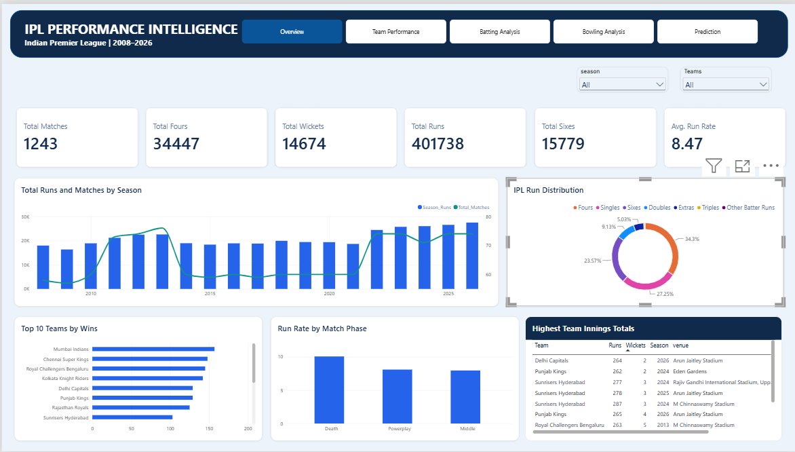
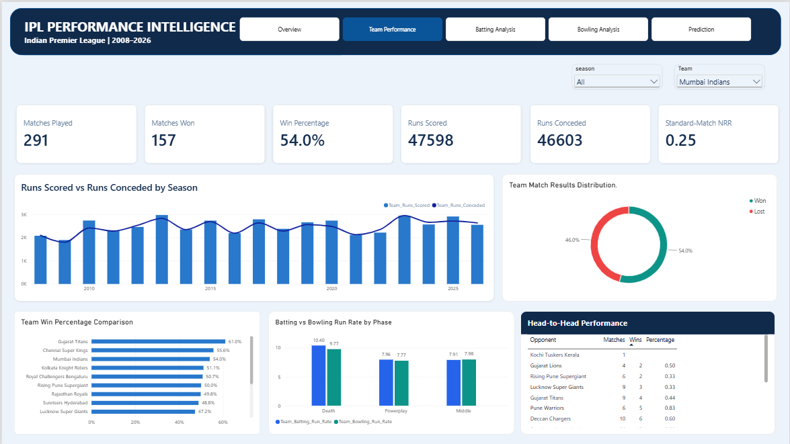
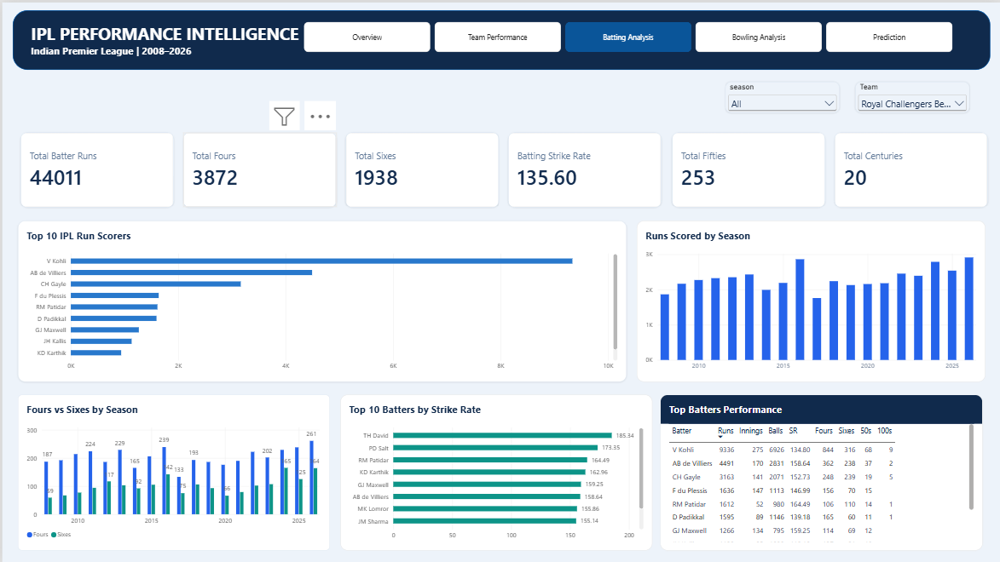
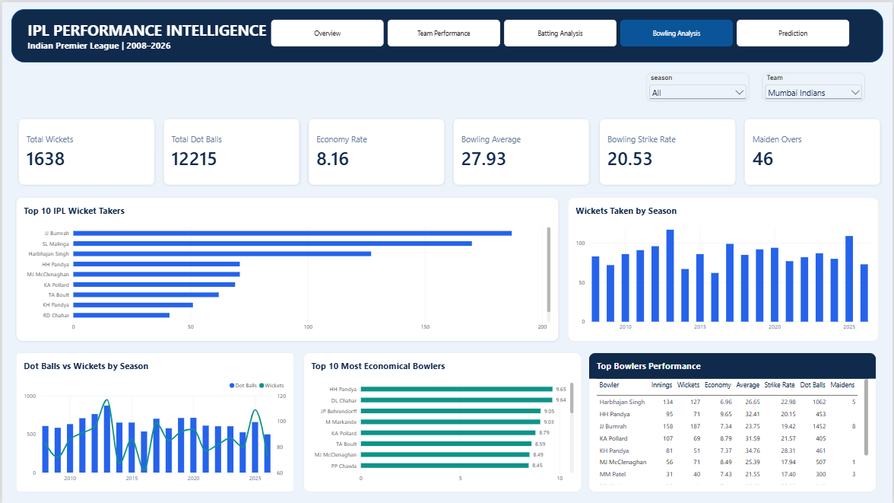
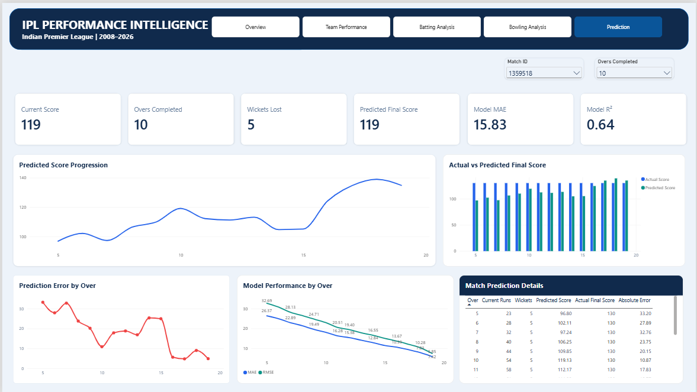

# 🏏 IPL Performance Intelligence

**A five-page Power BI report on IPL performance, plus a machine learning model that estimates an innings' final score from its progress.**


<!-- **[🔗 Live dashboard](YOUR_POWER_BI_PUBLIC_URL)** -->

---

## At a Glance

| | |
|---|---|
| **Data** | IPL match-level and ball-by-ball records |
| **Report** | 5 interactive pages: league, teams, batting, bowling, score prediction |
| **Model** | `HistGradientBoostingRegressor` predicting final innings total |
| **Validation** | Chronological split: 945 training matches, 237 test matches |
| **Test results** | MAE **15.83** runs · RMSE **21.26** runs · R² **0.644** |
| **Tools** | Power BI, DAX, Power Query, Python, pandas, NumPy, scikit-learn, Joblib |

---

## 📸 Preview

| Executive Overview | Team Performance |
|:---:|:---:|
|  |  |

| Batting Analysis | Bowling Analysis |
|:---:|:---:|
|  |  |



*Screenshots show example selections. Values change with filters.*

---

## 🎯 Motivation

Ball-by-ball IPL data can answer far more than "who won." I wanted one place where anyone could explore teams, batters, bowlers, and scoring trends without writing SQL or Python, and where descriptive analytics connects to a practical ML question:

> **Given what has happened so far in an innings, how close can a model get to the final total?**

---

## 🧭 Report Pages

| Page | What it answers | Highlights |
|---|---|---|
| **1. Executive Overview** | How has IPL scoring evolved? | Runs and matches by season, run rate by phase, top teams, highest totals |
| **2. Team Performance** | How do teams compare with bat, ball, and results? | Win %, runs scored vs. conceded, phase-wise run rates, head-to-head, estimated NRR |
| **3. Batting Analysis** | Who scores the most, and how fast? | Top run scorers, fours vs. sixes, strike rate (min-balls rule), fifties and centuries |
| **4. Bowling Analysis** | Who takes wickets and controls runs? | Top wicket takers, dot balls, economy (min-balls rule), average, strike rate, maidens |
| **5. Score Prediction** | How good is the model at each stage of an innings? | Predicted vs. actual score, error by over, MAE/RMSE by over |

### Cricket-aware metric definitions

- **Strike rate** uses balls faced, excluding wides.
- **Bowler wickets** exclude run-outs and other non-bowler dismissals; total match dismissals are tracked separately.
- **Economy and bowling strike rate** use legal deliveries and count only bowler-chargeable extras.
- **Estimated NRR** is derived from the available data and is **not** the official IPL standings NRR.

---

## 🤖 Score Prediction Model

**Task:** Predict the final innings total at a given checkpoint.

**Features:** batting team, bowling team, current score, wickets lost, overs completed, current run rate, runs in the last 5 overs, wickets in the last 5 overs.

**Pipeline**

1. Convert ball-by-ball data into innings-progress checkpoints after each completed over (overs 5 to 19).
2. Attach each innings' actual final score as the target.
3. Split **chronologically**, so later matches form the test set and no future information leaks into training.
4. Train a `HistGradientBoostingRegressor`.
5. Export predictions and metrics to CSV for Power BI.

Three problematic innings were excluded during data validation.

### Results (historical test set)

| Metric | Value | Meaning |
|---|---:|---|
| MAE | **15.83 runs** | Average absolute error |
| RMSE | **21.26 runs** | Error measure that penalizes large misses |
| R² | **0.644** | Share of variance in final totals explained |

### How the dashboard uses it

Page 5 shows **saved predictions for historical test matches**. Choosing a Match ID and Overs Completed retrieves the stored prediction and compares it with the actual score. It does not call the Python model live. This makes every prediction checkable against a known outcome and shows how error shrinks as an innings progresses.

These results describe a historical test split. They are not a guarantee for future matches.

---

## 💡 Key Insights

<!-- Fill these in from your own dashboard. Examples of the format: -->
- *Example: Scoring in the final overs has risen since season X.*
- *Example: Model error falls from ~X runs at over 5 to ~Y runs at over 19.*
- *Example: Team A's win rate is highest when batting first/chasing.*

---

## 📁 Repository Structure

```text
IPL_Performance_Intelligence/
├── IPL_Performance_Intelligence.pbix
├── README.md
├── requirements.txt
├── Screenshots/
├── data/
│   ├── ipl_matches.csv            # Source data (see license note)
│   ├── ipl_ball_ball.csv          # Source data (see license note)
│   ├── ipl_predictions.csv        # Test-set predictions
│   ├── model_metrics.csv          # Overall metrics
│   └── over_performance.csv       # Metrics by completed over
└── ml/
    ├── IPL_Score_Prediction.ipynb
    └── models/
        ├── ipl_score_model.pkl
        └── feature_columns.pkl
```

---

## 🚀 Getting Started

### Open the Power BI report

1. Install [Power BI Desktop](https://powerbi.microsoft.com/desktop/).
2. Clone or download this repository.
3. Open `IPL_Performance_Intelligence.pbix`.
4. If Power BI reports missing files, update the data source paths to your local `data/` folder.

### Rerun the ML notebook

```bash
git clone YOUR_REPOSITORY_URL
cd IPL_Performance_Intelligence
python -m venv .venv

# Windows:  .venv\Scripts\activate
# macOS/Linux:  source .venv/bin/activate

pip install -r requirements.txt
jupyter notebook ml/IPL_Score_Prediction.ipynb
```

Update the notebook's input and output paths before running all cells.

---

## ⚠️ Limitations

- Predictions are saved historical results, not live inference.
- Model metrics apply to one chronological split.
- Player and team statistics depend on naming conventions in the source data.
- NRR is an analytical estimate, not the official figure.
- A fresh clone may need path updates and dependency version checks.

## 🔭 Next Steps

- Add a Streamlit or FastAPI app for on-demand predictions from user-entered match situations.
- Break down model error by early, middle, and late innings.
- Add player/team ID mapping to handle historical name changes.
- Refresh data with new seasons and pin dependency versions.

---

## 📄 Data Source and License

**Source:** *add dataset URL here*
**License:** *add license here*

If the license does not allow redistribution, remove the two source CSVs from this repository and add instructions for obtaining them.

---

*Independent portfolio project. Not an official IPL or BCCI product.*
